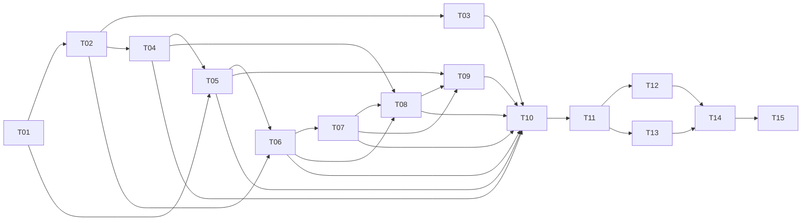

# Planeación del proyecto

## Propósito

Crear una aplicación web en español para jugar al juego de dados en navegadores de escritorio y móviles. El MVP cubre configuración, partida animada, eliminación, victoria e historial local. La siguiente etapa incorpora identidad visual mediante avatares de jugador.

## Estado actual del proyecto

El MVP está completo y validado. La Etapa 2 está planificada, pero su implementación aún no ha comenzado. El plan y tareas originales del MVP se conservaron en [docs/PLANNING-MVP.md](./docs/PLANNING-MVP.md) y [docs/TASKS-MVP.md](./docs/TASKS-MVP.md).

| Tarea | Estado |
|---|---|
| T01 — Inicializar la aplicación | ✅ Completada |
| T02 — Modelar las reglas del juego | ✅ Completada |
| T03 — Probar reglas y casos límite | ✅ Completada |
| T04 — Implementar historial local | ✅ Completada |
| T05 — Crear la bienvenida y configuración | ✅ Completada |
| T06 — Implementar el flujo y estado de partida | ✅ Completada |
| T07 — Construir la mesa de juego | ✅ Completada |
| T08 — Mostrar victoria y resultados | ✅ Completada |
| T09 — Adaptabilidad, animación y accesibilidad | ✅ Completada |
| T10 — Validación integral y entrega | ✅ Completada |
| T11 — Definir catálogo y modelo de avatares | ⚪ No asignada |
| T12 — Elegir avatar en la configuración | ⚪ No asignada |
| T13 — Persistir avatar en el historial | ⚪ No asignada |
| T14 — Mostrar avatares durante y después de la partida | ⚪ No asignada |
| T15 — Validar la experiencia de avatares | ⚪ No asignada |

El detalle y los criterios de aceptación están en [TASKS.md](./TASKS.md). Las tareas T01–T10 corresponden al MVP completado; T11–T15 componen la Etapa 2.

## Roles y responsabilidades

| Rol | Responsabilidades |
|---|---|
| Dueño del producto / reglas | Confirmar reglas, decisiones abiertas y criterios de aceptación. El reglamento de `README.md` es la referencia aprobada. |
| Agente de desarrollo | Diseñar e implementar funcionalidades, mantener documentación y tareas, escribir pruebas y reportar límites o decisiones pendientes. |
| Revisión de UX y accesibilidad | Comprobar que los controles y estados sean comprensibles, responsivos, utilizables con teclado y compatibles con movimiento reducido. Puede asumirlo el agente de desarrollo en este MVP. |
| QA / validación | Verificar casos de reglas, estados de interfaz, persistencia local y flujos completos en móvil y escritorio. Puede asumirlo el agente de desarrollo en este MVP. |

## Alcance

### Incluido en el MVP

- Aplicación SPA para navegadores, en español y con diseño mobile-first.
- Bienvenida con selección de 2 a 8 participantes, nombres, marcador inicial (20 por defecto, entre 10 y 50) y orden aleatorio o manual.
- Turnos con seis dados de seis caras, hasta cinco lanzamientos, selección/apartado de dados, suma acumulada, ataques, pérdida de puntos y eliminación.
- Lista ordenada de participantes con marcador, jugador activo, próximo jugador y último jugador que completó un turno.
- Animación de lanzamiento orgánica con apariencia tridimensional y cambios de estado, respetando la preferencia de movimiento reducido.
- Pantalla de victoria con ganador, resumen y acción para comenzar una nueva partida.
- Consulta de las diez partidas terminadas más recientes, guardadas en el almacenamiento local del navegador.

## Etapa 2 — Identidad visual de jugadores

### Objetivo

Permitir asignar a cada participante uno de los veinte avatares incluidos en `src/assets/player-icons/`, mantener la selección durante la partida y mostrarla en el tablero, el resultado final y el historial local.

### Alcance y decisiones

- Permitir elegir uno de los veinte avatares para cada participante durante la configuración y mostrarlo en la mesa, la victoria y el historial local.
- Los avatares se identifican con IDs estables definidos en un catálogo tipado; los nombres de archivo no se construyen dinámicamente desde datos de usuario.
- Se permiten avatares repetidos entre participantes.
- `player1.jpg` es el avatar predeterminado para partidas nuevas y para registros antiguos que no incluyan avatar.
- El resumen persistido guarda el ID del avatar, no la imagen codificada ni una URL remota.
- Los datos actuales del historial (versión 1) se migran al leerlos; los registros existentes reciben el avatar predeterminado. Al guardarse, el historial usa el nuevo formato versionado.
- Los archivos de imagen son recursos estáticos importados desde la aplicación. No se incluyen subidas de imágenes de usuarios, cuentas, backend ni sincronización en esta etapa.
- La selección y sus estados deben ser operables con teclado, tener nombres accesibles y adaptarse a móvil.

### Fuera de alcance de esta etapa

- Elegir imágenes desde el dispositivo o recortarlas.
- Cambiar reglas, marcador o flujo de turnos.
- Sincronizar avatares o historial entre dispositivos.

### Fuera de alcance

- Servidor, cuentas, autenticación, sincronización en la nube y juego multijugador en red.
- Reanudar partidas que estaban en curso después de recargar o cerrar el navegador.
- Rankings compartidos, chat, publicidad, pagos, analítica o integración con servicios externos.
- Aplicación nativa para iOS/Android; el producto será una web adaptable.

## Decisiones iniciales y supuestos

- El reglamento vigente está en `README.md`; no se altera durante la implementación sin aprobación.
- Los resultados guardados son resúmenes de partidas finalizadas, no una copia recuperable de una partida en curso.
- Se conservan las diez partidas más recientes por navegador/dispositivo. `localStorage` puede borrarse desde el navegador y no sincroniza entre dispositivos.
- Nombres vacíos reciben un nombre predeterminado como «Jugador 1». Los identificadores internos son únicos aunque dos personas usen el mismo nombre.
- La selección del objetivo de ataque se hace por dirección (siguiente o anterior), eligiendo al jugador activo más cercano en esa dirección.
- Los dados y el sorteo del orden usan un generador inyectable en la lógica para que las pruebas no dependan del azar real.

## Tecnologías

La aplicación utiliza React, TypeScript, Vite, Vitest, Testing Library, ESLint y Playwright:

- **React + TypeScript + Vite** para la SPA y el flujo de desarrollo/build.
- **CSS estándar** con variables CSS y media queries; no añadir una biblioteca visual salvo que una necesidad concreta lo justifique.
- **Vitest** para pruebas unitarias y de integración, con **Testing Library** para componentes.
- **Playwright** para los flujos críticos de navegador y comprobaciones de viewport responsive.
- **`localStorage`** como almacenamiento local de resúmenes de partidas, encapsulado detrás de un adaptador tipado y versionado.

No se requiere backend ni paquete de gestión de estado para esta escala; React y un reducer/controlador de partida son suficientes. Las dependencias instaladas se registran en el lockfile.

## Arquitectura propuesta

La estructura completa, incluidos los archivos de documentación y el estado actual del repositorio, se describe en [README.md](./README.md). La siguiente estructura de `src/` es prevista: las carpetas se crearán conforme se necesiten. Mantener el dominio independiente de la interfaz y del navegador:

```text
src/
  index.html           documento de entrada de Vite
  main.tsx              entrada de React
  assets/
    player-icons/       catálogo de avatares locales
  app/                 composición de pantallas y navegación sencilla
  domain/              modelos y reglas puras de dados, turnos y marcadores
  features/
    setup/             configuración y validación de participantes
    game/              estado/controlador y componentes de partida
    history/           lista y presentación de resultados recientes
  components/          componentes visuales compartidos
  persistence/         adaptador localStorage, validación y migración del historial
  styles/              estilos globales, tokens y breakpoints
```

- Las funciones de `domain/` reciben datos y devuelven resultados nuevos; no leen ni modifican DOM, React ni almacenamiento.
- El controlador/reducer aplica acciones permitidas y produce el estado siguiente de la partida. Los componentes presentan el estado y envían acciones.
- Para T07, `features/game/gameFlow.ts` expone `startGame`, `rollGameDice`, `selectGameDice`, `attackTargets`, `chooseAttack`, `advanceTurn` y `nextPlayer`. Sus fases distinguen el turno en juego, la selección de objetivo, el resultado y la victoria; el tablero debe usar el estado actualizado en cada acción.
- El adaptador de `persistence/` valida y guarda resúmenes versionados con identificador único y fecha ISO; rechaza datos inválidos o versiones incompatibles sin sobrescribirlos y comunica errores de almacenamiento a la interfaz.
- Al terminar la partida, la mesa crea un `GameSummary` con un `id` único y `finishedAt` en formato `Date.toISOString()` y lo entrega a `saveHistory`. Guardar el mismo resumen dos veces no lo duplica; la pantalla de victoria informa si se lanza un `HistoryError`.
- El historial contiene fecha, ganador, participantes y marcadores finales, más información breve para el resumen. No contiene datos personales fuera de los nombres ingresados por los jugadores.
- La interfaz mantiene los resultados legibles en móvil; la lista de jugadores puede ubicarse debajo del tablero o presentarse en un panel compacto en pantallas estrechas.
- Las pruebas unitarias y de componentes se colocan junto al código correspondiente; las pruebas de navegador se ubican en `tests/e2e/`.

## Reglas de codificación y calidad

- TypeScript en modo estricto; no usar `any` ni conversiones de tipo para ocultar estados inválidos.
- Mantener nombres de funciones, tipos y variables en inglés; interfaz, mensajes y documentación de producto en español.
- Preferir componentes pequeños y funciones puras; no duplicar reglas entre UI, persistencia y pruebas.
- Modelar explícitamente límites del juego: 2–8 jugadores, marcador 10–50, seis dados, cinco lanzamientos, objetivo 30 y eliminación a cero.
- No dejar errores en silencio: validar datos de entrada y almacenamiento, y mostrar errores recuperables de manera comprensible.
- Probar casos límite de reglas, transiciones de estado y fallos de almacenamiento; usar azar determinista en pruebas.
- Usar HTML semántico, foco visible, etiquetas accesibles y controles utilizables con teclado y tacto.
- Respetar `prefers-reduced-motion`; la animación es decorativa y no debe ocultar resultados ni bloquear interacciones.
- La animación de dados representa los valores calculados por el controlador: no genera resultados ni modifica dados apartados. Con movimiento reducido debe mostrar inmediatamente las caras finales.
- Evitar dependencias de ejecución innecesarias. Toda dependencia nueva debe resolver una necesidad del MVP y quedar reflejada en el lockfile.

## Dependencias entre tareas

Los detalles y criterios de aceptación están en `TASKS.md`. Grafo de prerrequisitos:



Lectura de dependencias:

- T02 y la configuración inicial de T05 requieren el andamiaje de T01 y pueden desarrollarse en paralelo; T05 necesita T04 para completar el historial.
- T03 y T04 requieren el modelo/reglas de T02.
- T06 integra reglas y configuración (T02 y T05); T07 construye la interfaz sobre el flujo de T06.
- T08 requiere historial (T04), estado de partida (T06) y mesa de juego (T07).
- T09 ajusta las vistas principales (T05, T07, T08).
- T10 valida el MVP completo y depende de las tareas anteriores enumeradas en `TASKS.md`.
- T11 define los IDs y el valor predeterminado; T12 integra la selección, T13 amplía la persistencia, T14 presenta los avatares y T15 valida la etapa completa.

## Criterio de entrega del MVP

El MVP está listo cuando las tareas T01–T10 cumplen sus criterios, las reglas coinciden con `README.md`, los flujos de configuración a victoria funcionan y el historial local puede consultarse sin que una falla de almacenamiento impida jugar.

## Criterio de entrega de la Etapa 2

La Etapa 2 estará lista cuando T11–T15 cumplan sus criterios, los avatares se mantengan correctamente en partidas nuevas e históricas y los flujos pasen las pruebas unitarias, de integración y navegador.
