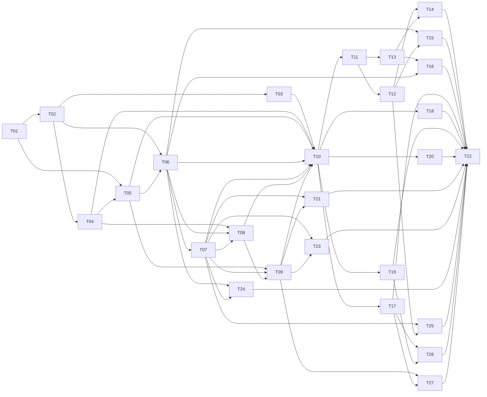

# Planeación del proyecto

## Propósito

Crear una aplicación web para jugar al juego de dados en navegadores de escritorio y móviles. El MVP cubre configuración, partida animada, eliminación, victoria e historial local. La Etapa 2 incorpora avatares, partidas con IA, clasificación, inglés/español, identidad visual y páginas informativas.

## Estado actual del proyecto

El MVP y la Etapa 2 están completos y validados. Se pueden configurar avatares y participantes humanos/IA, la IA juega automáticamente, la mesa, los resultados y el historial muestran avatares, y los resultados incluyen la clasificación final. La interfaz, contacto, preguntas frecuentes y «About» admiten inglés y español; la bienvenida incluye un video de ayuda local. El logo aparece en la aplicación y la pestaña, el último dado disponible se aparta automáticamente, la mesa señala a los líderes activos y los ataques al único rival se resuelven automáticamente. El historial versionado conserva los avatares y migra los registros antiguos. La validación incluyó 97 pruebas unitarias y de integración, 38 pruebas de navegador, lint, build y comprobación de recursos en producción. El plan y tareas originales del MVP se conservaron en [docs/MVP/PLANNING-MVP.md](./docs/MVP/PLANNING-MVP.md) y [docs/MVP/TASKS-MVP.md](./docs/MVP/TASKS-MVP.md).

| Tarea | Estado |
|---|---|
| T01 — Inicializar la aplicación | ✅ Completada |
| T02 — Modelar las reglas del juego | ✅ Completada |
| T03 — Probar reglas y casos límite | ✅ Completada |
| T04 — Implementar historial local | ✅ Completada |
| T05 — Crear la bienvenida y configuración | ✅ Completada |
| T06 — Implementar el flujo y estado de partida | ✅ Completada |
| T07 — Construir la mesa de juego | ✅ Completada |
| T08 — Mostrar victoria y resultados | ✅ Completada |
| T09 — Adaptabilidad, animación y accesibilidad | ✅ Completada |
| T10 — Validación integral y entrega | ✅ Completada |
| T11 — Definir catálogo y modelo de avatares | ✅ Completada |
| T12 — Configurar avatares y participantes humanos/IA | ✅ Completada |
| T13 — Persistir avatares y migrar el historial | ✅ Completada |
| T14 — Mostrar avatares en resultados e historial | ✅ Completada |
| T15 — Implementar tres dificultades de IA | ✅ Completada |
| T16 — Crear y guardar la clasificación final | ✅ Completada |
| T17 — Añadir inglés y español | ✅ Completada |
| T18 — Integrar logo y favicon | ✅ Completada |
| T19 — Crear páginas de contacto y sugerencias | ✅ Completada |
| T20 — Crear la página de preguntas frecuentes | ✅ Completada |
| T21 — Simplificar el cierre al quedar un dado | ✅ Completada |
| T23 — Señalar con una corona a los líderes | ✅ Completada |
| T24 — Atacar automáticamente al único objetivo disponible | ✅ Completada |
| T25 — Mostrar en el tablero los avatares seleccionados | ✅ Completada |
| T26 — Crear la página «About» y contar la historia del juego | ✅ Completada |
| T27 — Mostrar un video de cómo jugar | ✅ Completada |
| T22 — Validar e integrar la Etapa 2 | ✅ Completada |

El detalle y los criterios de aceptación están en [TASKS.md](./TASKS.md). Las tareas T01–T10 corresponden al MVP completado; T11–T27 componen la Etapa 2.

## Roles y responsabilidades

| Rol | Responsabilidades |
|---|---|
| Dueño del producto / reglas | Confirmar reglas, decisiones abiertas y criterios de aceptación. El reglamento de `README.md` es la referencia aprobada. |
| Agente de desarrollo | Diseñar e implementar funcionalidades, mantener documentación y tareas, escribir pruebas y reportar límites o decisiones pendientes. |
| Revisión de UX y accesibilidad | Comprobar que los controles y estados sean comprensibles, responsivos, utilizables con teclado y compatibles con movimiento reducido. Puede asumirlo el agente de desarrollo en este MVP. |
| QA / validación | Verificar casos de reglas, estados de interfaz, persistencia local y flujos completos en móvil y escritorio. Puede asumirlo el agente de desarrollo en este MVP. |

## Alcance

### Incluido en el MVP

- Aplicación SPA para navegadores, en español y con diseño mobile-first.
- Bienvenida con selección de 2 a 8 participantes, nombres, marcador inicial (20 por defecto, entre 10 y 50) y orden aleatorio o manual.
- Turnos con seis dados de seis caras, hasta cinco lanzamientos, selección/apartado de dados, suma acumulada, ataques, pérdida de puntos y eliminación.
- Lista ordenada de participantes con marcador, jugador activo, próximo jugador y último jugador que completó un turno.
- Animación de lanzamiento orgánica con apariencia tridimensional y cambios de estado, respetando la preferencia de movimiento reducido.
- Pantalla de victoria con ganador, resumen y acción para comenzar una nueva partida.
- Consulta de las diez partidas terminadas más recientes, guardadas en el almacenamiento local del navegador.

## Etapa 2 — Personalización y funcionalidades ampliadas

### Objetivo

Ampliar la experiencia del MVP con avatares, participantes controlados por personas o por IA, clasificación final, selección de idioma, identidad visual y páginas de información y contacto. Las reglas de dados se mantienen sin cambios.

### Avatares e identidad de jugadores

- Permitir elegir uno de los veinte avatares para cada participante durante la configuración y mostrarlo en la mesa, la victoria y el historial local.
- Los avatares se identifican con IDs estables definidos en un catálogo tipado; los nombres de archivo no se construyen dinámicamente desde datos de usuario.
- El modelo de jugador y la validación de IDs residen en `domain/`; el catálogo de imágenes importadas está en `assets/`. Los nuevos resúmenes guardan el ID del avatar en el historial versión 2.
- Se permiten avatares repetidos entre participantes.
- `player1.jpg` es el avatar predeterminado para partidas nuevas y para registros antiguos que no incluyan avatar.
- El resumen persistido guarda el ID del avatar, no la imagen codificada ni una URL remota.
- Los datos actuales del historial (versión 1) se migran al leerlos; los registros existentes reciben el avatar predeterminado `player1`. El primer guardado posterior escribe la versión 2.
- Los IDs inválidos en historiales de versión 2 siguen causando un error recuperable y no se sobrescriben. Si una imagen válida no carga, se muestra el avatar predeterminado y un aviso.
- El esquema versión 2 guarda la clasificación como lista ordenada de IDs de jugador; los registros anteriores pueden carecer de ella.
- Los archivos de imagen son recursos estáticos importados desde la aplicación. No se incluyen subidas de imágenes de usuarios, cuentas, backend ni sincronización en esta etapa.
- La selección y sus estados deben ser operables con teclado, tener nombres accesibles y adaptarse a móvil.

### Participantes controlados por IA

- Cada participante se configura como persona o IA; pueden coexistir participantes humanos e IA en una misma partida.
- Los turnos de IA se ejecutan automáticamente; la confirmación de salida los pausa hasta que se decida continuar o salir.
- Se ofrecen tres dificultades. La dificultad fácil elige aleatoriamente entre acciones legales; la media intenta acercar el resultado a 30; la difícil evalúa las jugadas y el objetivo de ataque considerando marcadores y supervivencia. Media y difícil estiman los resultados suponiendo un lanzamiento futuro de los dados restantes, sin optimizar exhaustivamente todos los lanzamientos posibles.
- La IA utiliza las mismas acciones legales y transiciones del flujo de juego que una persona. No altera resultados de dados ni las reglas.
- La dificultad se elige por participante IA. El comportamiento debe ser determinista en pruebas mediante azar inyectable.

### Clasificación final

- Al terminar, mostrar el orden completo de la partida: el ganador ocupa el primer lugar y el orden de los demás participantes es el inverso de su orden de eliminación; quien salió primero ocupa el último lugar.
- Guardar la clasificación en el resumen de la partida del historial local, junto con los datos ya existentes.
- Los registros antiguos sin clasificación siguen siendo legibles; se informa que el orden de clasificación no está disponible, sin deducirlo de los marcadores.
- Conservar el límite de diez partidas recientes y la validación/migración versionada del historial.

### Indicador de liderazgo durante la partida

- Mostrar una corona junto a cada jugador activo con el mayor puntaje actual en la lista de jugadores de la mesa; en caso de empate, todos los líderes reciben la corona.
- Actualizar el indicador cuando cambien los marcadores o haya eliminaciones. La corona no altera las reglas ni la clasificación final por orden de eliminación.
- Acompañar el icono con una descripción accesible y localizada. No se requiere mostrarlo en la clasificación final ni en el historial.

### Mejora de interacción al quedar un dado

- Si al comenzar un lanzamiento solo queda un dado disponible, lanzar ese dado debe apartarlo automáticamente con el valor obtenido, sin requerir una selección manual.
- Después de ese lanzamiento, ofrecer una única acción explícita y localizada para confirmar el cierre del turno, por ejemplo «Continuar con el siguiente jugador».
- La confirmación continúa el flujo normal de resolución del turno. Si el ataque tiene varios objetivos posibles, elegir la dirección sigue siendo obligatorio; no se omiten reglas ni resultados.
- Una IA confirma automáticamente; para una persona se muestra el resultado antes de avanzar al siguiente turno.
- La mejora es de interfaz y no modifica las reglas de selección, suma, límite de lanzamientos ni resolución de ataques.

### Mejora de interacción al atacar al único objetivo posible

- Si solo hay un jugador activo elegible como objetivo distinto del atacante, resolver el ataque automáticamente contra ese jugador sin pedir una dirección redundante.
- Si hay varios objetivos activos, conservar la elección entre dirección siguiente y anterior, aplicando el ataque al participante activo más cercano en la dirección elegida.
- El daño, la eliminación y el avance del turno siguen las reglas vigentes; esta mejora solo elimina una decisión que no puede cambiar el destinatario.

### Idiomas

- El idioma predeterminado de la interfaz es inglés; español es opcional.
- El usuario puede cambiar el idioma y la elección se recuerda en el almacenamiento local de ese navegador.
- La preferencia se valida y guarda por separado en un formato versionado; los valores inválidos vuelven a inglés sin modificar el historial. Los errores de lectura o escritura se muestran sin impedir jugar.
- Toda la interfaz, las páginas nuevas y los mensajes accesibles deben estar disponibles en ambos idiomas.
- La interfaz y las páginas de contacto, preguntas frecuentes y «About» están traducidas.
- Los datos del historial y las reglas del juego son independientes del idioma elegido.

### Logo y páginas informativas

- El dueño del producto proporcionó `src/assets/icon.jpg` para el logo de la aplicación y el favicon del tab.
- El logo de 128 píxeles y el favicon PNG de 32 píxeles se derivan de esa imagen y se empaquetan localmente.
- La página de contacto y sugerencias ofrece un enlace `mailto:` a `santiarrto@gmail.com`. No se envían datos mediante backend ni servicios externos. La navegación está disponible desde la bienvenida y se oculta durante la partida para no interrumpirla.
- La página de preguntas frecuentes explica las reglas aprobadas en `README.md` y las funciones incluidas en el producto.
- La página «About» explica el juego y acredita a Santiago Arredondo, con una anécdota sobre las partidas y apuestas compartidas con compañeros de trabajo durante los almuerzos. La mención de apuestas es histórica y no incorpora apuestas ni pagos a la aplicación.
- Las páginas están disponibles en inglés y español y son accesibles desde la navegación de la aplicación.
- En la bienvenida y configuración, un botón de ayuda con icono de pregunta reproduce el video local `src/assets/video/dice-brawl.mp4` en un diálogo accesible y adaptable, con controles y opción de cierre. No aparece durante la partida.

### Fuera de alcance

- Servidor, cuentas, autenticación, sincronización en la nube y juego multijugador en red.
- Reanudar partidas que estaban en curso después de recargar o cerrar el navegador.
- Rankings compartidos, chat, publicidad, pagos, analítica o integración con servicios externos.
- Aplicación nativa para iOS/Android; el producto será una web adaptable.
- Subir o editar imágenes de avatar desde el dispositivo.

## Decisiones iniciales y supuestos

- El reglamento vigente está en `README.md`; no se altera durante la implementación sin aprobación.
- Los resultados guardados son resúmenes de partidas finalizadas, no una copia recuperable de una partida en curso.
- Se conservan las diez partidas más recientes por navegador/dispositivo. `localStorage` puede borrarse desde el navegador y no sincroniza entre dispositivos.
- Nombres vacíos reciben un nombre predeterminado como «Jugador 1». Los identificadores internos son únicos aunque dos personas usen el mismo nombre.
- La selección del objetivo de ataque se hace por dirección (siguiente o anterior), eligiendo al jugador activo más cercano en esa dirección.
- Los dados y el sorteo del orden usan un generador inyectable en la lógica para que las pruebas no dependan del azar real.

## Tecnologías

La aplicación utiliza React, TypeScript, Vite, Vitest, Testing Library, ESLint y Playwright:

- **React + TypeScript + Vite** para la SPA y el flujo de desarrollo/build.
- **CSS estándar** con variables CSS y media queries; no añadir una biblioteca visual salvo que una necesidad concreta lo justifique.
- **Vitest** para pruebas unitarias y de integración, con **Testing Library** para componentes.
- **Playwright** para los flujos críticos de navegador y comprobaciones de viewport responsive.
- **`localStorage`** como almacenamiento local de resúmenes de partidas, encapsulado detrás de un adaptador tipado y versionado.

No se requiere backend ni paquete de gestión de estado para esta escala; React y un reducer/controlador de partida son suficientes. Las dependencias instaladas se registran en el lockfile.

## Arquitectura propuesta

La estructura completa, incluidos los archivos de documentación y el estado actual del repositorio, se describe en [README.md](./README.md). La siguiente estructura de `src/` es prevista: las carpetas se crearán conforme se necesiten. Mantener el dominio independiente de la interfaz y del navegador:

```text
src/
  index.html           documento de entrada de Vite
  main.tsx              entrada de React
  assets/
    player-icons/       catálogo de avatares locales
  app/                 composición de pantallas y navegación sencilla
  domain/              modelos y reglas puras de dados, turnos y marcadores
  features/
    setup/             configuración y validación de participantes
    game/              estado/controlador y componentes de partida
    history/           lista y presentación de resultados recientes
  components/          componentes visuales compartidos
  persistence/         adaptador localStorage, validación y migración del historial
  styles/              estilos globales, tokens y breakpoints
```

- Las funciones de `domain/` reciben datos y devuelven resultados nuevos; no leen ni modifican DOM, React ni almacenamiento.
- El controlador/reducer aplica acciones permitidas y produce el estado siguiente de la partida. Los componentes presentan el estado y envían acciones.
- Para T07, `features/game/gameFlow.ts` expone `startGame`, `rollGameDice`, `selectGameDice`, `attackTargets`, `chooseAttack`, `advanceTurn` y `nextPlayer`. Sus fases distinguen el turno en juego, la selección de objetivo, el resultado y la victoria; el tablero debe usar el estado actualizado en cada acción.
- El adaptador de `persistence/` valida y guarda resúmenes versionados con identificador único y fecha ISO; rechaza datos inválidos o versiones incompatibles sin sobrescribirlos y comunica errores de almacenamiento a la interfaz.
- Al terminar la partida, la mesa crea un `GameSummary` con un `id` único y `finishedAt` en formato `Date.toISOString()` y lo entrega a `saveHistory`. Guardar el mismo resumen dos veces no lo duplica; la pantalla de victoria informa si se lanza un `HistoryError`.
- El historial contiene fecha, ganador, participantes y marcadores finales, más información breve para el resumen. No contiene datos personales fuera de los nombres ingresados por los jugadores.
- La interfaz mantiene los resultados legibles en móvil; la lista de jugadores puede ubicarse debajo del tablero o presentarse en un panel compacto en pantallas estrechas.
- Las pruebas unitarias y de componentes se colocan junto al código correspondiente; las pruebas de navegador se ubican en `tests/e2e/`.

## Reglas de codificación y calidad

- TypeScript en modo estricto; no usar `any` ni conversiones de tipo para ocultar estados inválidos.
- Mantener nombres de funciones, tipos y variables en inglés; interfaz, mensajes y documentación de producto en español.
- Preferir componentes pequeños y funciones puras; no duplicar reglas entre UI, persistencia y pruebas.
- Modelar explícitamente límites del juego: 2–8 jugadores, marcador 10–50, seis dados, cinco lanzamientos, objetivo 30 y eliminación a cero.
- No dejar errores en silencio: validar datos de entrada y almacenamiento, y mostrar errores recuperables de manera comprensible.
- Probar casos límite de reglas, transiciones de estado y fallos de almacenamiento; usar azar determinista en pruebas.
- Usar HTML semántico, foco visible, etiquetas accesibles y controles utilizables con teclado y tacto.
- Respetar `prefers-reduced-motion`; la animación es decorativa y no debe ocultar resultados ni bloquear interacciones.
- La animación de dados representa los valores calculados por el controlador: no genera resultados ni modifica dados apartados. Con movimiento reducido debe mostrar inmediatamente las caras finales.
- Evitar dependencias de ejecución innecesarias. Toda dependencia nueva debe resolver una necesidad del MVP y quedar reflejada en el lockfile.

## Dependencias entre tareas

Los detalles y criterios de aceptación están en `TASKS.md`. Grafo de prerrequisitos:



Lectura de dependencias:

- T02 y la configuración inicial de T05 requieren el andamiaje de T01 y pueden desarrollarse en paralelo; T05 necesita T04 para completar el historial.
- T03 y T04 requieren el modelo/reglas de T02.
- T06 integra reglas y configuración (T02 y T05); T07 construye la interfaz sobre el flujo de T06.
- T08 requiere historial (T04), estado de partida (T06) y mesa de juego (T07).
- T09 ajusta las vistas principales (T05, T07, T08).
- T10 valida el MVP completo y depende de las tareas anteriores enumeradas en `TASKS.md`.
- T11 define los IDs y el valor predeterminado; T12 integra los avatares y el tipo de participante; T13 amplía la persistencia. T14 presenta avatares en resultados e historial, y T25 los muestra en el tablero.
- T15 implementa las decisiones de IA sobre el flujo ya existente (T06) y la selección de tipo de participante (T12). T16 construye el ranking a partir del flujo de eliminación y lo persiste en el historial (T13).
- T17 añade traducciones y preferencia local; T18 integra el logo suministrado por el dueño del producto. T19, T20 y T26 añaden páginas informativas; T26 reutiliza las traducciones y la navegación de T17 y T19. T21 mejora el cierre del turno cuando queda un dado y T23 señala a los líderes; ambas usan la mesa y accesibilidad existentes (T07 y T09). T24 adapta el flujo de ataques para resolver sin intervención cuando solo existe un objetivo. T25 conecta los avatares configurados con la lista de jugadores del tablero. T27 incorpora el video de ayuda con accesibilidad y traducciones (T09 y T17). T22 valida todas las funcionalidades en conjunto.

## Criterio de entrega del MVP

El MVP está listo cuando las tareas T01–T10 cumplen sus criterios, las reglas coinciden con `README.md`, los flujos de configuración a victoria funcionan y el historial local puede consultarse sin que una falla de almacenamiento impida jugar.

## Criterio de entrega de la Etapa 2

La Etapa 2 estará lista cuando T11–T27 cumplan sus criterios: avatares y tipos de participante se conservan y muestran en la mesa, los resultados y el historial; las tres dificultades de IA siguen las reglas; la clasificación final se muestra y persiste; la mesa señala a los líderes; inglés es el idioma predeterminado y la elección se recuerda; el logo se usa también como favicon; contacto, FAQs y «About» funcionan en ambos idiomas; el video de ayuda se reproduce en un diálogo accesible; el cierre con un único dado requiere solo la confirmación final, sin selección manual; y un ataque contra el único objetivo posible se resuelve automáticamente. Los flujos deben pasar pruebas unitarias, de integración y navegador en escritorio y móvil.
